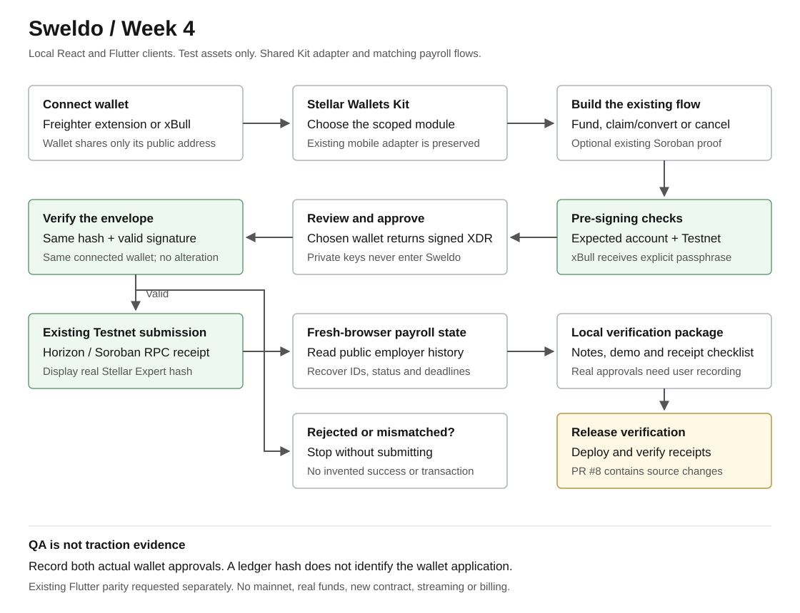
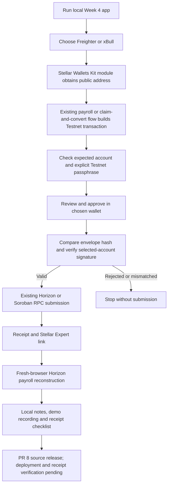

# Week 4: Stellar Wallets Kit and Final Verification

## Scope

The SOW's Week 4 work is:

> Integrate Stellar Wallets Kit for Freighter plus at least one additional Stellar wallet, run end-to-end QA, deploy update, and publish verification package.

Expected output:

> Live dApp URL, GitHub PR/code links, 3-5 minute demo, how-it-works notes, and transaction-hash receipt list.

The Week 4 source, dependencies, tests and guides are collected on `heinric/week-4-wallets-kit` in [PR #8](https://github.com/mrHeinrichh/sweldo/pull/8), following the earlier focused signing-guard and funding-error commits. The [supplied demo recording](https://drive.google.com/file/d/1b8a5aGYPnLdT1uSq54mbWJX-d-z0HCRu/view?usp=sharing) shows the local build. The updated deployment, final wallet-by-wallet receipt verification and physical-phone signing evidence remain **pending**. The supplied video is 5:21; the SOW asks for a 3-5 minute final demo. Do not report the complete SOW milestone as externally accepted before the remaining checks are completed.

Supported Week 4 kit wallets:

- **Freighter extension**, through Stellar Wallets Kit's Freighter module.
- **xBull**, through Stellar Wallets Kit's xBull module. The extension is recommended for this demo; the module also supports xBull's web-wallet popup.
- The pre-existing **Freighter app** WalletConnect path remains available if configured. It is not counted as a second wallet brand.

There is no mainnet support, no real money, no new contract, no streaming payroll, no billing and no additional asset pair. The subsequent user-requested update brings the existing Flutter app to matching functionality; see the [Flutter parity demo](flutter-web-parity-demo.md). This does not represent an additional SOW mobile-app deliverable.





## 1. Start from the beginning

Use Node 22.18 or newer. The project has existing public Week 1 test-asset evidence under `.sweldo-local/`.

Open Terminal:

```bash
cd "/Users/heinric/Documents/Stellar Hackathon"
npm install
npm run week4:configure
npm run week4:test
npm run week2:test
npm run week3:test
npm run week4:dev -- --port 5174 --strictPort
```

Keep that last command running. Open **http://localhost:5174/**. If a local Week 4 server is already running there, open it without starting another instance. Close the first-visit guide with Escape.

Use the `localhost` hostname for the xBull extension. Its HTTP content-script permissions cover `http://localhost/*`, not `http://127.0.0.1/*`. The numeric loopback address can prevent extension detection and cause the connector to open the separate web wallet, which may say no wallet has been set up even when the extension is unlocked. Cancel that request, open the localhost URL in the same browser/profile, reload, and reconnect. Do not recreate or import a wallet just to resolve this hostname issue.

**Result:** Sweldo opens locally, the header shows Testnet, and **Connect wallet** offers Freighter extension and xBull on desktop. New sessions default to **XLM**. The currency dropdown inside **Total pay** also offers **USDC** (controlled Test-USDC) when the existing controlled issuer is configured. No secret keys are in Vite configuration. Local app hosting is not an offline ledger: wallet-signed manual tests still interact with public Stellar Testnet.

`week4:configure` does not send transactions. It creates `.env.week4.local` from public Week 1 asset identities and an empty `.sweldo-local/week4-receipts.json` template, without overwriting a completed receipt file. Existing public registry configuration in `.env.local` still applies. If the Week 1 evidence is missing, configure the existing Week 1 setup separately rather than entering real asset issuers.

## 2. Prepare two separate wallets

1. Install/unlock [Freighter](https://www.freighter.app/) and [xBull](https://xbull.app/). Use disposable **Testnet-only** accounts you control, not a real-funds wallet.
2. Select Testnet in Freighter. Select Testnet in xBull for the same demonstration context.
3. Have an employer and a separate worker public G address. Never paste a seed phrase or password into Sweldo, CSV, screenshots or the receipt template.
4. Fund both accounts with free Testnet XLM using the wallet's Testnet funding option or Sweldo's **Get free test XLM** prompt. The worker needs XLM for trustline reserves and fees.

**Important xBull detail:** its kit module does not implement `getNetwork`. Sweldo does not pretend to read xBull's selected network. It explicitly supplies the Testnet passphrase to every signing request and verifies the returned signature against that network and the expected public key. The wallet request must show Testnet. xBull can ask you to confirm the public account again immediately before signing.

## 3. Verify both wallet connections

1. Click **Connect wallet** and choose **Freighter extension**.
2. Approve access. The top-right control changes to your public address.
3. Open the address menu. It identifies **Freighter extension / Testnet**. Copy the employer public key.
4. Click **Disconnect**, then **Connect wallet**, then **xBull**.
5. Approve the xBull connection. Its menu identifies **xBull / Testnet**.

If you use xBull's web wallet instead of its extension, allow the wallet popup opened from the local Sweldo page. Keep the wallet popup open until approval or explicitly reject it; a blocked popup cannot complete signing.

**Result:** each brand connects through its kit module. Rejection leaves the app disconnected (or keeps a previous session). No funding or payout is sent merely by connecting. xBull does not silently reopen its wallet on page reload; reconnect it deliberately. Freighter may restore an already-authorized session without an access prompt.

## 4. Record a worker conversion with xBull

This exercises the existing Week 2 flow through the new second wallet. It is a manual, public **Testnet** test, not a localhost-only ledger simulation.

1. Connect the **worker** in xBull. Copy its public G address and make sure it is funded on Testnet.
2. In a second Terminal, prepare a supported payout using the existing Week 2 helper:

   ```bash
   npm run week2:prepare -- --testnet --worker YOUR_XBULL_WORKER_PUBLIC_KEY --delay 60
   ```

   This existing command sends a **Testnet** funding transaction using the ignored disposable Week 1 demo account. It is not an xBull or Freighter signing receipt. Do not count it as wallet-brand evidence.

3. Save its funding hash and balance ID. In the browser click **My pay**, refresh, and wait for the 60-second unlock.
4. Click **Claim as PHPT** on that 25 test-USDC payout. Verify the quoted PHPT amount, minimum received and exact test issuers.
5. Click **Claim and convert**. Approve the expected worker and Testnet transaction in xBull. Missing trustlines are included in the existing atomic transaction.
6. Save the displayed claim/conversion hash and open **Verify on Stellar Expert**.
7. In Terminal run:

   ```bash
   npm run week2:verify -- YOUR_XBULL_CLAIM_CONVERSION_HASH
   ```

**Result:** the worker claims 25 controlled test-USDC and receives a positive PHPT amount at least equal to the quoted minimum. The same successful transaction contains the claim and strict-send path payment. It includes trustline operations if needed. The actual rate depends on the existing Testnet offer, so do not invent a fixed PHPT result.

If the quote fails for missing liquidity, stop before signing and restore the existing Week 1 setup separately. If old Testnet accounts or offers were reset, this is a fixture prerequisite, not permission to create a new token or market as Week 4 work.

Repeat steps 1-7 with a separate **Freighter worker** if you want both wallets to demonstrate conversion. `week2:prepare` overwrites the expected payout file, so verify each claim before preparing the next payout.

## 5. Test wallet-signed batch payroll in the UI

### Choose the asset explicitly

1. Open **Pay your team**. In the currency dropdown on the right edge of **Total pay**, leave **XLM** for the original XLM payroll test with either wallet. Only Testnet XLM is needed for the payroll amount, fees and payout reserves; a USDC trustline or test-USDC faucet is not needed.
2. For the existing USDC-to-PHPT acceptance flow, select **USDC** there before entering amounts or importing CSV. This means the configured controlled Test-USDC, not real USDC. Each employee row shows the same selection: it changes the asset for the whole new payroll draft, not individual workers, a wallet setting or an existing payout. Selecting it clears the previous draft receipt without modifying saved/ledger history.
3. For Test-USDC, fund the employer with test XLM if needed, select **Enable USDC** and approve the trustline, then select **Get 25 test-USDC** when its available balance is zero. The funding prompt is hidden for any positive USDC balance, including balances below 25; it can return when a refreshed balance reaches zero. A funding receipt stays visible after the prompt disappears. Enabling USDC alone never adds funds.

Amounts are not exchange-rate converted when changing the dropdown: `6 XLM` becomes a draft for `6 USDC`, requiring a new review. The control is unavailable during payroll submission or account funding/trustline approval. Reloading starts with XLM again. Worker payouts always use their actual ledger asset, regardless of the employer draft selection. XLM payouts offer ordinary Claim; only the configured Test-USDC issuer offers Claim as PHPT. Mixed-asset worker totals are listed separately.

This is a bounded usability choice between two already-supported Testnet assets, not an additional SOW deliverable, new asset pair, automatic swap, new network or wallet requirement. Wallets Kit integration is independent of the selected payroll asset.

This funding button is a local Week 4 development helper, not a production faucet. Its dev-server endpoint issues only 25 units of the existing controlled test-USDC to a funded, trusted Testnet account. The disposable issuer key stays in ignored server-side files, never in the browser or Flutter bundle. The endpoint rejects external origins, requires a local request token, serializes issuer transactions and blocks repeated/uncertain submissions. It does not run in production builds or other Vite modes. Funding from this helper is test setup, not proof that Freighter or xBull signed a payroll transaction. No token is sent merely by opening the page.

1. Disconnect the worker. Connect a **Freighter employer** with the existing configured test-USDC asset and sufficient test XLM reserves.
2. Click **Pay your team**, select **USDC** at the right of **Total pay**, enter the first worker public key, and continue to Schedule. Select **3 times**, **every minute**, and **In 1 minute**, then go **Back** to Team. This sets the payout count before validating the CSV totals. Click **Import roster** and paste:

   ```csv
   wallet,name,amount,cadence
   YOUR_FIRST_WORKER_PUBLIC_KEY,Employee A,6,minute
   YOUR_SECOND_WORKER_PUBLIC_KEY,Employee B,9,minute
   ```

3. Click **Preview roster** and **Use roster**. Amounts are total payroll amounts, not amounts per payout.
4. Continue to Schedule. Choose **Live demo** and **3 payouts**, every minute, starting in one minute. Confirm the displayed values; presets may retain prior choices, so set them explicitly.
5. Continue to Review. Check **2 employees x 3 payouts**, **15 test-USDC**, with Employee A receiving **3 x 2** and Employee B **3 x 3**.
6. Click **Lock payroll on Stellar**. Approve in Freighter. If the existing Soroban registry is configured and live, approve its existing proof transaction too.
7. Save the native batch funding hash, exact balance IDs and optional registry hash.
8. After a worker claim or pre-deadline employer cancellation, reload Payroll history and verify the correct status and receipt.
9. Repeat a small batch with an **xBull employer** that already holds the controlled test-USDC, to test the same signing flow with the second wallet. No paid/mainnet USDC is needed or accepted. The existing Week 1 sample accounts may supply test assets, but do not expose their secrets or give them to testers.

**Result:** one native batch transaction creates six claimable balances totaling 15 test-USDC. An optional second transaction records existing Soroban metadata for the first schedule, not all workers. A worker claim is **Claimed**; a pre-deadline employer return is **Cancelled**. Already-unlocked payouts cannot be cancelled. A declined optional registry approval does not undo successful native funding; report the registry item as pending separately.

Repeat with **XLM** and a funded XLM employer to verify the earlier XLM payroll still works. Review must show **15 XLM**, the transaction's claimable balances must use `native`, and the worker must receive XLM, not PHPT. Do not present an XLM-only test as proof of the USDC-to-PHPT deliverable.

## 6. Prove fresh-session recovery

1. Open a new private window at the same local URL.
2. Click **Pay your team**. Do not connect a wallet.
3. Paste the employer public key into **Employer public key** and click **Load payroll**.
4. Wait for **Checked**. Compare funding hash, worker keys, amount, payout count, balance IDs, deadlines and claim/cancellation receipts with the first browser.

**Result:** ledger-backed fields match without copying browser localStorage. Worker names may become **Team member** because names are session labels. This is the existing Week 3 implementation, regression-tested with the Week 4 wallet integration.

## 7. Negative checks

| Test | Expected result |
| --- | --- |
| Freighter is absent or locked | Connection error with an install/unlock action; no submission |
| Reject connection / close wallet popup | No new active session; retry or cancel connection |
| Cancel connection, then approve the old popup | Late approval cannot establish the cancelled session |
| Switch Freighter to Mainnet before signing | Stop before signing/submission; reconnect on Testnet |
| Switch the selected account | Intended-account check fails; no submission |
| Return altered, empty, unsigned or wrong-network XDR | Envelope/signature guard rejects it |
| Disconnect or switch wallets while signing | Returned signature is rejected before submission |
| Quote expires or no supported path exists | Existing conversion error; refresh only when safe |
| Horizon is unavailable | Show the error; never invent a receipt or a claimed status |
| Refresh fresh employer history without a wallet | Read-only inspection works; signing still requires employer |

The guards currently support the app's ordinary G-account transaction flow, not arbitrary multisig, hardware or fee-bump workflows.

## 8. Prepare the local verification package

Use [the checklist](week-4-verification-package.md). Fill `.sweldo-local/week4-receipts.json` with actual wallet-signed receipts, for example:

```json
{
  "wallet": "xbull",
  "kind": "claim-convert",
  "account": "YOUR_WORKER_PUBLIC_G_ADDRESS",
  "hash": "YOUR_ACTUAL_64_CHARACTER_TRANSACTION_HASH"
}
```

`wallet` is `freighter` or `xbull`; `kind` is `funding`, `claim-convert`, `cancellation` or `registry`. Never reuse one receipt to count both wallets.

```bash
npm run week4:verify -- .sweldo-local/week4-receipts.json
```

**Result:** read-only Horizon verification prints PASS/FAIL for submitted receipts and writes `.sweldo-local/week4-verification.json`. It checks successful transaction source, expected action, and the exact supported conversion asset pair. It checks employer identity/deadline for cancellation. Overall receipt coverage requires Freighter, xBull, a funding action and claim-and-convert. Empty templates fail. It does **not** certify deployment, PR publication or completed recording.

Wallet application names are not stored on the ledger. A hash cannot prove that a user chose xBull rather than Freighter; actual recordings must show the selected wallet and approval dialog. These are receipt consistency checks, not a production audit.

### Suggested 3-5 minute recording

| Time | Show and explain |
| --- | --- |
| 0:00-0:30 | Local URL and Testnet. "Week 4 adds Freighter and xBull through Stellar Wallets Kit." |
| 0:30-1:20 | Freighter employer connection, CSV preview, batch review and wallet approval. Open its successful funding receipt. |
| 1:20-2:30 | xBull worker connection and approval of Claim as PHPT. Show the real converted amount and hash. Prepare the payout before recording if needed. |
| 2:30-3:20 | Private-window employer-key-only recovery, balance IDs and correct claim/cancellation status. |
| 3:20-4:20 | Second wallet signing proof (another small batch or Freighter conversion), plus receipt checklist and optional existing registry receipt. |
| 4:20-5:00 | Explain Testnet-only, non-custodial custody and signature checks. State that deployment/PR are pending for this local-only version. |

Do not use mocked browser QA footage as user onboarding, real wallet approvals or ledger traction.

## Implementation notes

- `@creit.tech/stellar-wallets-kit` is pinned to **2.7.1**. Version 2's `init`, `setWallet`, `fetchAddress` and `signTransaction` APIs are used; this is not an old v1 constructor integration.
- Only Freighter and xBull modules are loaded. Existing Freighter Mobile remains a separate configured adapter.
- Existing native payroll, trustline handling, PHPT conversion and Soroban registry flows all use the shared `signXdr` boundary.
- Before returning a signed envelope, Sweldo checks Testnet, the expected source key, unchanged transaction hash and a valid signature from that key. Wallet changes during approval stop submission.
- Current xBull has no network-reporting API; its explicit Testnet request and returned signature are authoritative. xBull requires manual reconnect rather than surprise popups during restore.
- No wallet secret is handled or stored by this integration. No new contract is deployed.
- The kit's installed dependency tree has upstream audit advisories, including unused wallet dependencies. Only the two selected modules are bundled. Review those advisories before future production deployment; this Testnet validation is not a security audit.

## Local QA performed on 13 October 2026

- 16 Week 4 tests passed after separating the signing guard checks from wallet adapter and receipt checks.
- 19 Week 2 tests and 12 Week 3 tests passed: **47 automated tests in total**.
- Browser integration checks exercised the actual Freighter and xBull kit modules against mocked wallet bridges: both UI connections and signed XDR responses, mainnet rejection, rejected signing and changed accounts. Zero network transactions were submitted. These are QA, not external wallet evidence.
- Desktop and narrow-screen wallet picker layouts and the flowchart were visually checked.
- Read-only Horizon reconstruction still recovered the four existing schedules for the public Week 3 employer, including worker-claim and employer-cancellation history. Those are historical receipts, not new Week 4 transactions.
- Production build and lint passed, with the existing large-bundle and Fast Refresh warnings.
- `npm audit` reported 25 advisories (13 low, 7 moderate, 5 high) in the installed dependency tree. No broad dependency upgrades were applied as part of this bounded sprint.
- The empty receipt template was rejected as incomplete, as intended. Real Freighter/xBull approvals, fresh receipts, final recording, GitHub delivery and deployment remain pending.

Primary references: [Wallets Kit](https://stellarwalletskit.dev/), [Freighter module source](https://github.com/Creit-Tech/Stellar-Wallets-Kit/blob/main/src/sdk/modules/freighter.module.ts), [xBull module source](https://github.com/Creit-Tech/Stellar-Wallets-Kit/blob/main/src/sdk/modules/xbull.module.ts).

## Local Test Funding Follow-up, 14 October 2026

- Added the UI-only **Get 25 test-USDC** path for local testing, distinct from enabling the trustline. The displayed balance and receipt identify the result; no funding request is sent on page load.
- 60 web checks passed across the Week 2, Week 3 and Week 4 suites, including ten local-faucet transport/security/backend checks. React production build passed; the development-only faucet is not a production backend.
- Flutter's local funding client tests passed, along with three responsive funding-control/receipt widget tests. Flutter analysis and the debug web build passed. The SDK continues to emit its existing optional Wasm dry-run compatibility warnings; the JavaScript web build succeeded.
- Browser UI QA covered empty, loading, funded, failed and pending-confirmation states using an explicitly labelled mock fixture at desktop and 375px mobile widths. This is not a real funding receipt, wallet approval recording or user onboarding evidence.
- No live faucet POST, wallet approval, GitHub push or deployment was performed in this follow-up. Real funding occurs only when the tester selects the local UI action.
